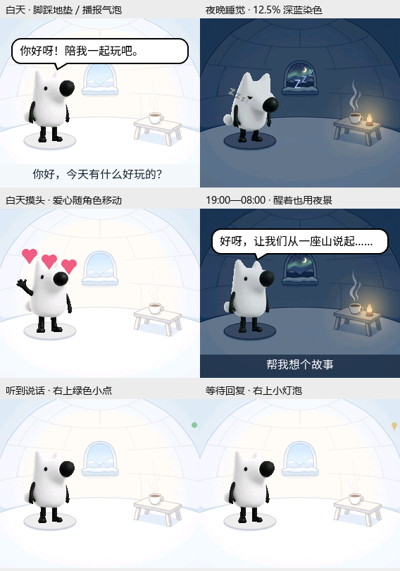

# 刘看山 ESP32-C5 桌宠

这是 [XiaoZhi](https://github.com/78/xiaozhi-esp32) 的 **ESP-SensairShuttle / ESP32-C5** 定制分支：128px 看山动画、
语音对话、漫画气泡、昼夜冰屋，以及 BME690 环境“鼻子”。

- **[完整中文技术文档](docs/c5/README.md)**
- [硬件引脚与子板互换](docs/c5/hardware.md) · [官方原理图 / PCB / 数据手册](docs/hardware/README.md)
- [构建与烧录](docs/c5/build-and-flash.md) · [桌宠交互](docs/c5/desktop-pet.md)
- [鼻子与 MCP](docs/c5/nose-and-mcp.md) · [验证记录与限制](docs/c5/validation-and-limits.md)



图为实际 LVGL 离屏渲染，非开发板截图；最新代码支持淡绿等待点与 VAD 加深提示，
其中 C5 本地 VAD 事件输入尚待实现，详见验证记录。

当前子板配置为 BME690，使用原配 Shuttle 插座时与 BMI270/BMM350 子板互换。
鼻子已通过自检和连续原始采样，**尚未训练具体气味分类模型**。最新源码和实机验证
的对应关系见验证记录，不把“能采集气体电阻”写成“已经识别气味”。

```sh
# 先加载 ESP-IDF 6.1 环境；不支持 IDF 5.x
python -m pip install Pillow
python custom_assets/build_eaf_assets.py --pack-only
python scripts/build.py espressif/esp-sensairshuttle --name esp-sensairshuttle --language zh-CN
idf.py -p COMx flash
```

固件使用 16 MB Flash / 8 MB PSRAM，素材分区位于 `0x800000`。发布包可由仓库
源资源重建；Flash/NVS 备份、热点配置和原始串口会话不上传。

## 上游与许可证

保留 XiaoZhi 公共框架与 Git 来源，当前分支聚焦 C5，CI 只构建本板型。
完整分支范围与合并说明见 [UPSTREAM.md](UPSTREAM.md)，保留原 [MIT 许可证](LICENSE)
及版权署名。上游通用功能与其他板卡说明请查阅 [XiaoZhi 原仓库](https://github.com/78/xiaozhi-esp32)。
