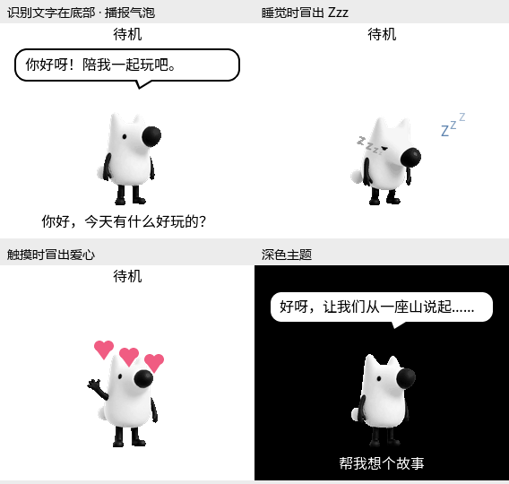

# C5 字幕与桌宠特效（2026-10-10）

> 历史实现记录；当前行为和监听提示见[桌宠与交互](c5/desktop-pet.md)，
> 烧录与实机状态见[验证记录](c5/validation-and-limits.md)。

本次仅为 `CONFIG_USE_KANSHAN_PET` 的 C5 看山界面增加叠加层，尚未烧录。
下文记录字幕版本；随后加入的昼夜背景及当前包大小见
[`c5-pet-scenes.md`](c5-pet-scenes.md)。

预览由工程内的 LVGL、实际素材包字体和原 GIF 的代表帧渲染，展示布局；
不是开发板截图，也不是动画帧率测试。运行时仍由原 EAF 播放器负责动作。

## 显示规则

- STT 的 `user` 文字单独显示在屏幕底部，长文字横向滚动。
- 播报的 `assistant` 文字显示在看山头顶的白底黑边圆角气泡中，带朝向头部
  的小尾巴；长句在气泡内滚动。新问题清除旧回答，回复不会覆盖底部用户文字。
- `system` 提示临时优先显示在底部并隐藏气泡；清空提示只恢复字幕，不会
  错误清除其他角色的文字。全局隐藏字幕同时隐藏底栏和气泡，桌宠特效继续。
- 睡眠动作开始时显示三个循环上浮的蓝色 `Z/z/z`，动作退出时立即隐藏。
  原睡眠素材自带的小字保持原样。
- 沿用现有有效屏幕触摸事件，显示三颗错峰上浮、渐隐的粉色爱心，约 1.8 秒
  自动结束；连续触摸重置效果，不累积对象。开机打招呼和语音“你好”不会
  误触发爱心。原触摸唤醒/打招呼及释放时切换对话的行为保留。

128×128 看山保持原尺寸。布局按当前字体行高计算：内置基础字体为 23 px，
加载素材包字体后为 25 px；当前 284×240 屏幕使用单行播报气泡。主机渲染
已检查气泡尾巴、看山边界和底部字幕互不遮挡。

## 实现与资源

`main/display/lvgl_display/pet_overlay.*` 独立管理字幕和特效，由 LCD 显示锁
保护；LVGL 定时器仅修改界面，不改应用状态，不重启 EAF，不运行在音频任务中。
触摸回调仍经 `Application::Schedule()` 投递到主任务，再调用显示接口。
未启用桌宠的显示实现使用默认空特效接口。

复用 13 个界面对象和一个 100 ms 定时器，只有睡眠或爱心生效时才运行。
爱心由圆和三角形绘制，Zzz 使用现有字体；未增加 GIF、PNG、画布或解码帧缓冲。
字幕常驻缓冲共 1536 B，超过容量时按 UTF-8 边界截断；两类普通字幕的长句
滚动显示，超出容量的部分不保留。

32 位主机离屏测试中 C++ 对象为 1612 B，创建后的堆增量为 4564 B（包含
对象、LVGL 控件、样式和定时器）。固件的普通 C++ 堆与 LVGL 堆分配方式不同，
上述数字是主机估计，不是实机 SRAM/PSRAM 测量。
素材包仍为 5,108,821 B，8 MiB assets 分区剩余 3,279,787 B；预览 PNG
仅放在文档目录，不进入固件素材包。

## 验证

- ESP-IDF v6.1.0，按规范命令选择 C5 配置后的最终增量构建通过，应用
  2,497,824 B，最小应用分区剩余约 40%。未构建 C3。
- 96 项现有主机测试通过，格式检查及 `git diff --check` 通过。
- 使用 C5 编译参数关闭桌宠宏，对 LCD、OLED 和基础 Display/NoDisplay
  接口进行语法检查，全部通过。
- 真实 LVGL 离屏检查通过：角色字幕保持/清除、系统提示优先级、隐藏后恢复、
  睡眠进入/退出、重复触摸、爱心结束、中文截断、布局边界和销毁后定时器清理。
  已检查浅色、深色、睡眠及触摸四个渲染画面，LVGL 堆完整性检查通过。
- 构建和离屏验证日志在 `tmp/c5_ui_20261010/`。应用 SHA-256：
  `9951334185c4810ae8b206af5ba430240bbb3ec7b9c818af00503d3557f8b1ff`。

尚未验证开发板上的长句滚动、实际刷新帧率、触摸手感和运行内存；未重新烧录，
NVS 配置未写入。此次固件包含前一轮尚未烧录的 PDM 时钟与功放门限调整，
详见 `c5-regression-repair.md`，不能把本轮界面验证当作音频硬件验证。
