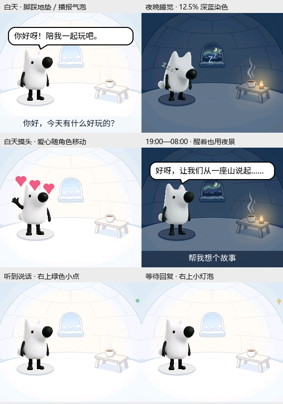

# C5 地垫落点、轻提示与夜间染色（2026-10-10 历史记录）

> 以下记录当时的未烧录版本。后续已烧录场景版本，当前状态见
> [验证记录](c5/validation-and-limits.md)；最新监听点的两级提示见
> [桌宠与交互](c5/desktop-pet.md)。

预览使用实际 LVGL、RGB565 背景、素材包字体及原 GIF 代表帧。角色帧转换为
官方 EAF 播放器使用的 RGB565A8 格式后绘制，非开发板截图或帧率测试。

## 位置与提示

284×240 冰屋的地垫中心约为 `(71,173)`，128×128 待机帧的两脚中心约为
`(67,123)`。因此角色画布左上角设为 `(4,50)`、中心为 `(68,114)`，相对
此前加载字体后的布局左移 74 px、上移 27 px。单纯左移 20–30 px 仍在垫外。
保留 128px 原尺寸，不裁剪素材；气泡尾巴、Zzz 和爱心同步跟随新中心。
没有冰屋素材的旧包继续使用原布局。

待机、监听、播报、连接的普通状态文字不再占据穹顶，待机时钟同样留空。
保存空标签而非仅隐藏控件，通知结束后不会重新露出“待机”。配网、激活、
升级、错误及临时通知仍通过原有渠道显示。

右上角使用一个复用的小控件：监听中检测到 VAD 语音显示柔和绿色小点，
连接、收到识别文字等待回复、或“帮我”的思考动作显示小灯泡；睡眠及平静时
隐藏。VAD 事件在应用主任务中更新显示，每秒刷新也会校正，不从音频回调
直接操作 LVGL。小灯泡由图形绘制，不需要增加表情字体或图片。

## 夜间融合与资源

夜景给角色施加 `#18385B`、`32/255`（约 12.5%）的 LVGL 图像染色，日景
透明度恢复为 0。官方 `lv_eaf_class` 继承 `lv_image_class`，所以真实 EAF 帧
和黑白回退照都可使用同一套样式。切换背景时更新已有播放器，新建播放器
也继承当前染色，不重启动作来改变光影，不修改透明通道或原素材。

素材包仍为 5,381,890 B，没有增加动画、贴图、常驻解码帧缓冲或任务。
离屏测试中叠加层约 4,788 B，比前版多约 224 B（包括一个控件和成员）。
LVGL 软件染色需要临时工作内存：C5 RGB565 屏幕宽 284 px，未旋转图像的
绘制暂存上限为 `4×284×2=2,272 B`，按块绘制后释放；旋转沿用 LVGL 变换
路径。它仍会增加绘制计算，真实 SRAM 低水位和动画帧率需要硬件确认。

## 验证

日志与离屏测试在 `tmp/c5_refinement_20261010/`。检查涵盖地垫落点、气泡与
角色可见区域、字幕分离、特效生命周期、RGB565A8 夜间染色和日间恢复、
图像源与透明数据不变、爱心经过气泡时字幕像素不被覆盖、LVGL 堆完整性。

- 100 项主机测试通过。
- ESP-IDF v6.1.0 的 C5 规范构建通过；应用 2,500,000 B，比背景接入版增加
  1,344 B，最小应用分区仍剩余 39%。未构建 C3。
- 六场景真实 LVGL 离屏渲染及上述回归检查通过，已目视检查预览。
- 关闭桌宠宏时，C5 LCD、OLED 与基础 Display/NoDisplay 语法检查通过。
- 触及的 C/C++ 文件格式检查和 `git diff --check` 通过。

应用 SHA-256：`a63d9eb6fcce08dea9e60ab7e8913da81423b684e1bc8b1eff860b498e13cb8d`。
素材包 SHA-256 仍为
`541d2e0af581d1789429dc2d4338423b1c37a6986d378b7afa5919c09bc1396a`。

未烧录，未写入 NVS；真实屏幕效果、音频并发时的帧率和内存低水位仍需
实机确认。上板需要新应用及此前新增昼夜背景的素材包。
