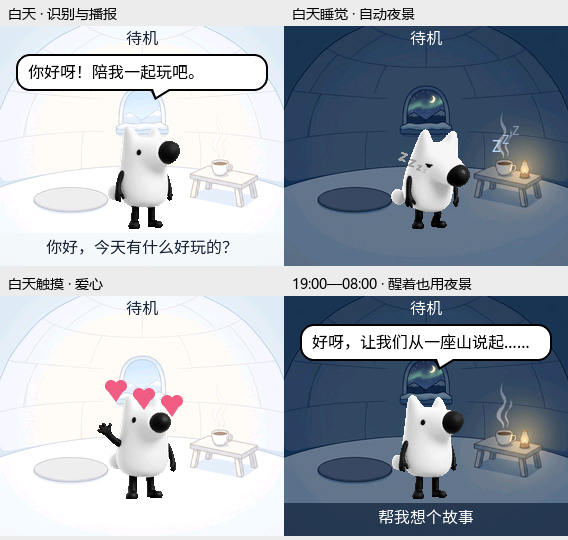

# C5 冰屋昼夜背景（2026-10-10 历史记录）

> 以下记录当时的未烧录版本；当前烧录、运行与后续修改状态见
> [验证记录](c5/validation-and-limits.md)。

本文记录背景接入版本；最新地垫位置、无待机文字的界面、夜间角色染色及
验证结果见 [`c5-pet-refinement.md`](c5-pet-refinement.md)。



预览使用工程内的 LVGL、实际打包的 RGB565 背景、素材包字体和原 GIF
代表帧离屏渲染，不是开发板截图。原圆角播报气泡、底部识别字幕、Zzz
和触摸爱心保留，夜景下状态文字和 Zzz 调整为浅色以便阅读。

## 切换规则

| 看山状态 | 本机时钟 | 背景 |
| --- | --- | --- |
| 睡眠 | 任意时间（含未同步） | 夜晚 |
| 醒着 | 19:00 ≤ 时间，或时间 < 08:00 | 夜晚 |
| 醒着 | 08:00 ≤ 时间 < 19:00 | 白天 |
| 醒着 | 未同步 | 白天 |

入睡、唤醒时立即检查；已有每秒状态刷新负责检查时间，因此即使正在播报
也可在时段边界切换。08:00 若仍在睡眠就继续显示夜景，醒来后才恢复日景。
19:00 只切换背景，不强制睡眠。后台使用现有服务器校时后的本机时钟，
与屏幕时钟一致，不另外叠加 UTC+8；没有有效年份时不把 Unix 初始时间
误认为午夜。缺少新背景的旧素材包回退原有背景，不阻止语音和动作运行。

昼夜判断规则位于 `main/pet/pet_scene_policy.h`，LCD 层选择已有
light/dark 主题的背景资源并覆盖必要文字颜色，不调用 `SetTheme()`，避免
自动切换时写入 NVS。只在选择发生变化时更新画面，不重建 EAF、字幕标签，
也不改变桌宠动作或语音状态。

## 素材和内存

源图为 `custom_assets/scenes/igloo_day_284x240.png` 和
`igloo_night_284x240.png`，原图保持不变，JPEG 备用图未进入发布包。

```sh
python custom_assets/build_eaf_assets.py --pack-only
```

命令将每张不透明 PNG 转换为 C5 的 32 位 LVGL9 CBin：28 B 描述符加
136,320 B RGB565 像素，保存在 `scene_day.bin` / `scene_night.bin`，并在
索引 `skin.light/dark.background_image` 中引用。尺寸不正确、透明源图、缺少
或损坏场景会拒绝打包，不回退到旧 48px 表情资源。

两张场景通过已有 assets 分区映射读取；运行时不需要 PNG/JPEG 解码，
不分配新的整屏背景像素缓冲或后台任务，沿用现有分条 DMA 刷屏。
32 位离屏测试验证 LVGL 解码结果直接引用源像素。描述符、共享所有权和
样式仍有少量对象开销；实机 SRAM、PSRAM、帧率尚未测量。

新包 5,381,890 B，共 11 个文件，8 MiB 分区剩余 3,006,718 B。
相比此前精简包增加 273,069 B，原六组 EAF、字体及唤醒模型八个资源均
逐字节一致。包 SHA-256：
`541d2e0af581d1789429dc2d4338423b1c37a6986d378b7afa5919c09bc1396a`。

## 验证状态

- ESP-IDF v6.1.0 的 C5 规范构建通过；应用 2,498,656 B，最小应用分区
  剩余约 39%。未构建 C3。
- 100 项主机测试通过，新增时间边界、睡眠优先级、未同步时钟、RGB565
  像素/描述符、真实打包回读、重打包保留及缺失/损坏背景拒绝等检查。
- 真实 LVGL 四场景离屏渲染及字幕/特效生命周期检查通过，背景源指针直接
  使用检查、LVGL 堆完整性检查通过；已经目视检查预览图。
- 关闭桌宠宏后，C5 的 LCD、OLED、基础 Display/NoDisplay 语法检查通过。
- 代码格式和 `git diff --check` 通过。日志及前一素材包在
  `tmp/c5_scenes_20261010/`，应用 SHA-256：
  `2be3be98ae029078b0426c0e9413bf9820ae282db3dd4e2bfd423415554a369d`。

尚未烧录、未写入 NVS；上板时必须同时更新应用和 `0x800000` 的素材包。
实际时间同步、昼夜切换、背景刷新与语音同时运行的表现仍需实机确认。
