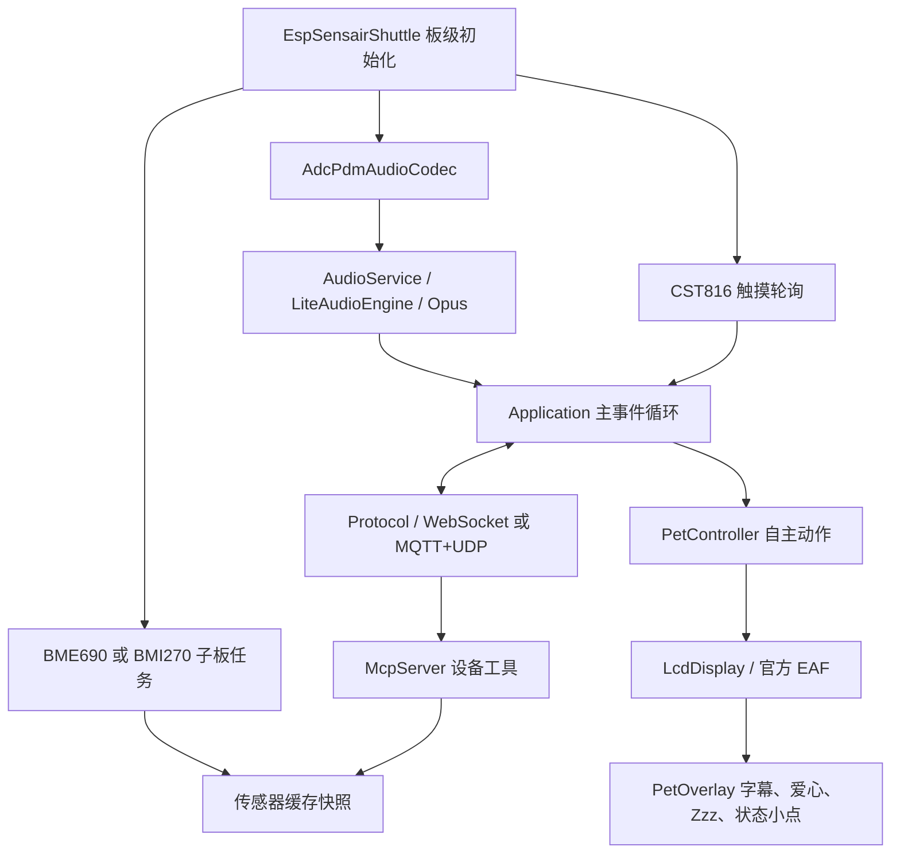

# 架构与代码导航

[返回目录](README.md)

## 构建身份

| 项目 | 当前选择 |
| --- | --- |
| 板卡目录 / 发布变体 | `espressif/esp-sensairshuttle` / `esp-sensairshuttle` |
| 芯片 / SDK | ESP32-C5；优先 ESP-IDF v6.1，最低 v6.0.1 |
| Flash / PSRAM | 16 MB / 8 MB |
| 主界面 | 标准 LVGL；官方 EAF 播放器；独立桌宠叠加层 |
| 子板模式 | `CONFIG_USE_BME690_NOSE=y`：鼻子；关闭后配合桌宠启用 BMI270 |

选择链为 `config.json → scripts/build.py → Kconfig → main/CMakeLists.txt → 板级源码`。
只通过 `DECLARE_BOARD(EspSensairShuttle)` 导出这一板级工厂。SDK 5.x 不支持。

## 运行数据流

C5 使用 `LiteAudioEngine`，不是 S3/P4 的完整 AFE 链路。不要因通用代码包含
AEC、MultiNet 或相机接口，就认为该 C5 发布配置启用了这些能力。
该 Lite 实现当前也没有产生本地 VAD 状态事件；UI 的 VAD 接口存在，不等于
C5 已提供语音活动检测，详见[待办](validation-and-limits.md)。

## 核心模块

| 位置 | 职责及修改边界 |
| --- | --- |
| [application.cc](../../main/application.cc) | 状态事件、连接、音频发送、STT/TTS 生命周期、桌宠事件投递 |
| [device_state_machine.cc](../../main/device_state_machine.cc) | 合法设备状态转换；状态修改通过 Application 入口 |
| [板级实现](../../main/boards/espressif/esp-sensairshuttle/esp-sensairshuttle.cc) | 引脚、I²C/SPI、触摸、音频、可选子板和板级 MCP 工具 |
| [ADC/PDM codec](../../main/boards/espressif/esp-sensairshuttle/adc_pdm_audio_codec.cc) | 官方 ADC DMA 适配、PDM、PA、音量、输入偏置与重试 |
| [AudioService](../../main/audio/audio_service.cc) | 输入/输出任务、编码解码和队列；详见[音频设计](../../main/audio/README.md) |
| [pet_controller.cc](../../main/pet/pet_controller.cc) | 动作优先级、口令、时间策略、动作序号和完成/超时处理 |
| [pet_idle_policy.h](../../main/pet/pet_idle_policy.h) | 待机 10 秒与无用户语音 30 秒的时间规则 |
| [lcd_display.cc](../../main/display/lcd_display.cc) | EAF 生命周期、场景选择、夜间染色、状态提示 |
| [pet_overlay.cc](../../main/display/lvgl_display/pet_overlay.cc) | 固定容量字幕、矢量气泡/爱心、小型 LVGL 特效 |
| [bme690_nose.cc](../../main/boards/espressif/esp-sensairshuttle/bme690_nose.cc) | 官方传感器 API、有效性检查、缓存快照与查询摘要 |
| [bmi270_pet_motion.cc](../../main/boards/espressif/esp-sensairshuttle/bmi270_pet_motion.cc) | 仅动作子板模式的姿态采样和动作事件 |
| [mcp_server.cc](../../main/mcp_server.cc) | 通用设备 MCP 协议；板级工具在板级构造中注册 |

## 两套独立状态

设备状态描述 `idle / connecting / listening / speaking / wifi_configuring` 等通信流程；
桌宠动作描述打招呼、玩耍、电脑、睡眠等视觉行为。设备开始播报时，桌宠可以
继续玩耍；桌宠瞌睡也不等于音频通道关闭。UI 状态小点反映通信状态，动作不替代它。

服务器表情不会覆盖 C5 的专用 `pet_*` 动作。动画完成回调携带动作序号，旧动作
回调不能结束新动作；丢失回调或解码失败有超时退路。

## 线程与所有权

- 应用状态和桌宠控制器由应用主任务管理。外部回调应投递事件或
  `Application::Schedule()`，不直接改核心状态。现有触摸的爱心事件和对话开关
  使用投递入口；遗留的启动期配网分支仍直接调用板级配网入口，后续重构需注意线程边界。
- LVGL 控件和样式在显示锁下访问。EAF 控件销毁时释放自身解码器、帧缓存及定时器。
- BME690 只由其采集任务操作 I²C；查询工具复制短快照后释放互斥锁，再创建 JSON。
  查询不等待加热器，不运行气体采样，不操作屏幕。
- 触摸与传感器共享原生 I²C 总线。传感器重试只移除自己的设备句柄，不删除总线。
- 字幕、特效复用固定对象；音频路径不反复分配大型临时缓冲，不阻塞主事件循环。
- MQTT/UDP 与 WebSocket 共享 `Protocol` 语义；本轮没有改动共享网络契约。

## 资源输入与构建输出

`main/`、`scripts/`、源 GIF/EAF、字体/唤醒模型及场景 PNG 是可维护输入。
`build/`、`managed_components/`、`sdkconfig` 和 mmap 头是生成内容，由 SDK/脚本管理。
发布素材包 `.bin` 可重建，不把本机全 Flash/NVS 备份当作资源输入。

旧的 idle/lowmem/GIF 打包目录是历史方案；当前生效入口是
`custom_assets/kanshan_eaf_v1`。`kanshan_motion_v1/staging/pet_*.gif` 仍是转换源，不能
因名称旧就删除。当前阶段没有为 PC 编写独立上位机应用。
