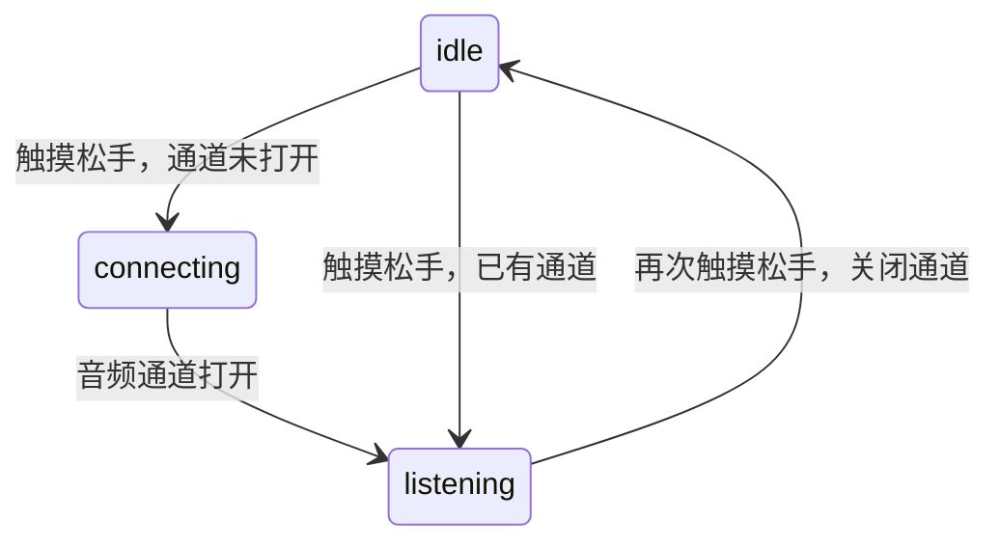

# 桌宠、字幕与交互

[返回目录](README.md) · [布局预览](../images/c5-pet-refinement-preview.png)

## 动作规则

| 条件 | 动作 | 说明 |
| --- | --- | --- |
| 开机、配网、解码回退 | 128×128 黑白照 | 固件内 Flash 资源，不依赖网络图片 |
| 资源准备好后的正常启动 | 打招呼 → 待机 | 开机打招呼一次 |
| 待机 10 秒 | 晃悠/玩耍 | 根据独立时间策略轮换 |
| 30 秒无用户语音活动 | 瞌睡 | TTS 播报不当作用户活动 |
| 识别完整短口令“你好” | 打招呼 | 约 4 秒 |
| 识别以“帮我”开头的口令 | 电脑/思考 | 约 6 秒 |
| 完整短口令“睡觉” | 瞌睡 | 命令匹配有长度和规范化限制 |
| 有效触摸按下 | 打招呼与爱心 | 不依赖 BMI270 |

“说出睡觉”也保留为兼容短口令。命令从用户 STT 输入匹配，不扫描助手 TTS
文字；不能通过助手自己说“睡觉”误触发。具体优先级见 `PetController` 和测试。

## 触摸是对话开关

按下有效坐标时显示爱心；松手后调用对话切换，两者是不同事件：

因此出现爱心不单独证明已经监听；监听中再点也不是重复“开始”，而是结束。
2026-11-08 的串口已记录 `idle → connecting → listening`，也记录了再次触摸的
`listening → idle`。配网时同一开关可进入/退出音频测试，不代表已连上语音服务。

当前状态提示位于右上角：等待说话为淡绿点，控件收到 VAD 活动后支持绿色加深；
连接或等待回复为小灯泡；平静待机隐藏。普通“待机/监听/播报”顶栏文字和
待机时钟不显示，激活、配网、升级和错误提示保留。桌宠瞌睡不关闭语音通道，
所以监听绿点不能被睡眠动作隐藏。最新双亮度提示已通过离屏渲染，待实机复核。

梳理源码发现 C5 的 `LiteAudioEngine` 只保存 VAD 回调，尚未产生本地 VAD 事件。
因此淡绿等待点可由监听状态驱动，而“按语音活动加深”还缺 C5 输入检测环节，
不能标为已完成。30 秒活动计时主要依赖唤醒、STT 等应用事件，不能声称连续
本地语音检测已完成保活。后续需补经验证的轻量检测，不直接套用 S3 的 AFE。

## 字幕和特效

- `user`：底部显示识别文字，新问题清除旧回答。
- `assistant`：头顶白底黑边圆角漫画气泡，长句在气泡内滚动，不覆盖用户文字。
- `system`：临时优先使用底栏并隐藏播报气泡；清除时不误清其他角色文字。
- 睡眠：三枚 Z/z/z 循环上浮；离开睡眠立即隐藏。
- 触摸：三颗矢量爱心错峰上浮、渐隐，重复触摸重置效果，不累积对象。
- 爱心和 Zzz 从气泡后方经过，不遮住播报文字；全局隐藏字幕不取消桌宠特效。

字幕缓冲为 768/384/384 B，总计 1536 B，超长文本按 UTF-8 边界截断。
无额外 GIF 或整屏画布。100 ms 效果定时器仅在睡眠/爱心活动时工作，静态
状态小点不新建定时器。32 位 LVGL 主机渲染中叠加层约 4788 B，不能把它直接
当成 C5 全部显示内存开销。

## 场景、位置与夜间光影

| 条件 | 背景 |
| --- | --- |
| 看山睡眠，无论时刻 | 夜景 |
| 已校时且 19:00 ≤ 时间或时间 < 08:00 | 夜景 |
| 已校时且 08:00 ≤ 时间 < 19:00，且醒着 | 日景 |
| 时钟未同步且醒着 | 日景 |

采用已有服务器校时后的本机时钟，不再加一次时区偏移。状态变化立即检查，
每秒刷新检查时间边界；19:00 只切背景，不强制睡眠。场景切换不写 NVS，
不重新创建播放器或重启动作；旧包缺背景时保留原背景。

284×240 冰屋中地垫中心约 `(71,173)`，128px 待机帧脚中心约 `(67,123)`。
角色画布左上角为 `(4,50)`、中心 `(68,114)`，与旧布局相比左移 74 px、
上移 27 px；不是把整个 128px 画布中心当成脚的位置。气泡尾巴与特效跟随。

夜景用 `lv_obj_set_style_image_recolor` 设置 `#18385B`，透明度 `32/255`
约 12.5%；日景恢复 0。真实 EAF 控件继承 LVGL 图像类，现有播放器、新建
播放器和黑白回退照均应用染色，alpha 保持不变。软件绘制有计算和临时内存
开销，未旋转图像暂存按当前 RGB565 屏宽推导上限约 2272 B，非零成本滤镜。

## 动画资源

| 动作资源 | 索引帧数 | 标称时长 |
| --- | --- | --- |
| pet_idle | 100 | 5 s |
| pet_greeting | 80 | 4 s |
| pet_sway | 60 | 3 s |
| pet_thinking | 120 | 6 s |
| pet_sleep | 100 | 5 s |
| pet_play | 80 | 4 s |

合计 540 索引帧，每帧 50 ms；标称 20 fps 不等于实际屏幕帧率。透明帧经
官方 EAF 解码为 RGB565+A8，单帧 49152 B，优先 PSRAM。背景通过 Flash
mmap 读取，不额外复制整屏；整机还需显示 DMA、字体缓存、任务栈和网络内存。
