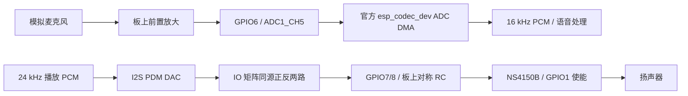

# C5 主板、子板与引脚

[返回目录](README.md) · [厂商资料和版本清单](../hardware/README.md)

对象为 ESP-SensairShuttle / ESP32-C5-WROOM-1-N16R8，16 MB Flash、8 MB PSRAM。
以下映射以本仓库 [config.h](../../main/boards/espressif/esp-sensairshuttle/config.h)、
板级实现及[乐鑫主板资料](../hardware/README.md)为依据；不是其他 C5 开发板的通用接线。

## 固件引脚表

| 功能 | GPIO / 接口 | 说明 |
| --- | --- | --- |
| 共享 I²C SDA / SCL | 2 / 3，I2C0 | 触摸与所选 Shuttle 子板共用 |
| Shuttle CS / SDO | 10 / 9 | I²C 时 CS 高；SDO 低选主地址；先预置电平再启用输出 |
| 麦克风 | 6，ADC1_CH5 | 模拟麦克风经过板上前置放大电路进入 ADC |
| PDM 正 / 负 | 7 / 8，I2S0 | 同一位流经 IO 矩阵输出，其中负路反相 |
| 功放使能 | 1 | PA_CTL 高使能；停止时先关闭 PA |
| LCD MOSI / CLK | 23 / 24，SPI2 | 40 MHz 面板时钟，DMA 分条传输 |
| LCD CS / DC | 25 / 26 | 无独立显示复位 GPIO，配置为 `GPIO_NUM_NC` |
| BOOT 按键 | 28 | 也与 Shuttle INT1 线路相关；本项目不启用 IMU 中断 |
| Shuttle INT2 | 0 | 本项目不用中断采集 |
| USB D- / D+ | 13 / 14 | 由主板连接至原生 USB Serial/JTAG |

RGB、外部扩展口和电源控制有主板线路，但不能因引脚存在就当成当前固件功能。
GPIO5 的扩展使用受主板装配选项约束，请查对应原理图，不随意复用。

## 显示与触摸

面板物理控制器为 ST7789P3，工程借用 `esp_lcd_ili9341` 加载自定义初始化表；
“用了 ili9341 组件”不代表硬件换成了 ILI9341。原生面板为 240×284，固件交换
坐标后 UI 为 284×240，X 偏移 36，`swap_xy=true`、`mirror_y=true`。

触摸器件资料使用 CST816T 系列标识；项目保留历史类名 `Cst816d`，地址 `0x15`，
轮询 50 ms。`4095,4095` 是无效坐标，不能把它当成屏幕边缘点击。有效按下
记录一次手势，松手只接受与该按下匹配的释放事件。

## 音频硬件与固件

采音为 12-bit ADC、16 kHz，DMA 池 4096 B、转换帧 640 B；该 640 B 是 ADC
记录帧，不是 640 B 的最终语音 PCM。输入任务栈 6144 B。软件估计并去掉实际
直流偏置，不假设模拟偏置恰好在量程中点。

PDM 使用官方 DAC 时钟配置，24 kHz 下 `fp=960/fs=240/bclk_div=13`，名义
位流约 6.144 MHz；这是配置推导值，本轮未用示波器测量。保留 HP DIV2 与
原 -50..0 dB 音量曲线，0 静音；NVS 音量值不会因刷入调试版而主动重置。

同源反相输出改善逻辑对称性，不会修复电源压降、地回流、模拟输入共模或 RC
装配误差。停止顺序为关 PA → 停 TX → 两路拉低，空闲关断滞回 300 ms。
300 ms 是开关滞回，不是新增 300 ms 语音缓存；底噪改善尚无声压/频谱实测结论。

## 两类原配子板互换

| 固件选择 | 原配子板 | 地址 | 当前用途 |
| --- | --- | --- | --- |
| `CONFIG_USE_BME690_NOSE=y` | BME690 | `0x76`，SDO 高可为 `0x77` | 温湿压、原始气体电阻、自检与查询 |
| 鼻子关闭、桌宠开启 | BMI270/BMM350 | BMI270 `0x68`；BMM350 `0x14` | BMI270 姿态/摇晃；BMM350 罗盘未启用 |

原配主板只有一个对应 Shuttle 插座，本项目按互换子板设计，不按两块原配子板
同时插入设计。鼻子模式不会编译/启动 BMI270 采集任务，不再反复打印缺失 IMU。
子板更换不会取消自主动画或触摸爱心；只有依赖 IMU 的姿态/摇晃输入不再提供。

原配子板选择 3.3 V 供电。CS/SDO 初始化集中在板级层，传感器服务不再次驱动
这些引脚。BMI270 已被 CS 跳变锁定成 SPI 时，单靠重新探测 I²C 无法恢复，需要
重新上电；这与 BME690 自检或串口波特率不是同一问题。

## 硬件资料使用

[资料目录](../hardware/README.md)列出主板 V1.0、BME690 V1.0 和官方当前
BMI270/BMM350 V1.1 的原理图、PCB PDF，以及芯片/屏幕资料。先核对实际 PCB
丝印版本；官方链接名称与下载到的版本均在校验清单中记录，不把 V1.1 静默标成 V1.0。

鼻子的气体敏感面需要接触环境空气，外壳不能把其封闭成只有外观的鼻尖。
安装热源、湿度和自热都会影响读数；当前温度是传感器测量值，未完成整机室温补偿。
